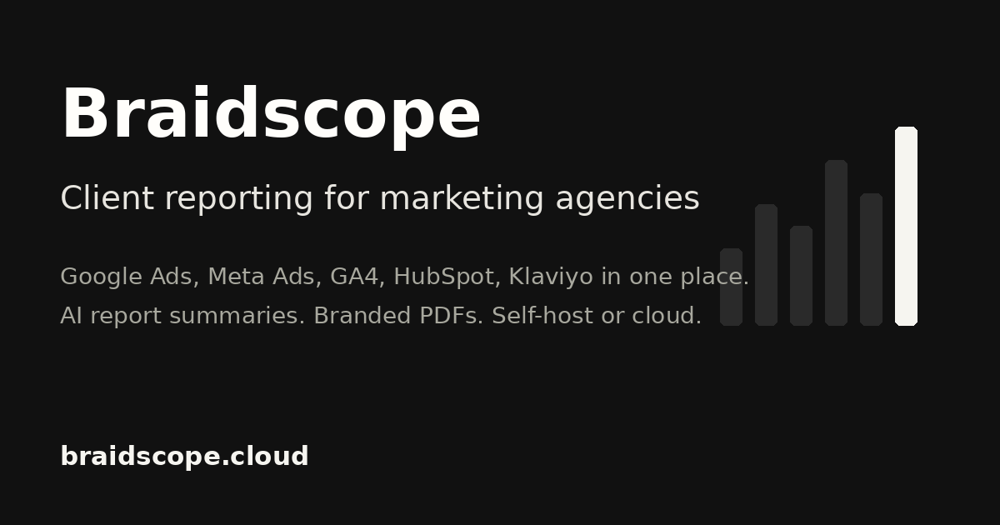

# Braidscope

**Open-source client reporting for marketing agencies.** Every client's ad and analytics numbers in one
place, with your agency's branding. Self-host it in one command, or use our cloud.

> **Status: preparing for public release.** This repository is private while the open-core split
> finishes. Nothing here is a public promise yet.



## Who this is for

- Marketing agencies with 8 to 30 active clients.
- Teams that run Meta Ads or Google Ads for clients and spend Monday mornings on reports.
- Anyone who wants client reporting on their own server, with their own data.

## What works today

| Area | Status |
|---|---|
| One workspace per client, team invites, roles (owner, admin, editor, viewer) | Live |
| Google Ads and Meta Ads dashboards | Live |
| Date ranges, world map, per-source dashboards | Live |
| Ask AI over connected data, with your own API key | Live |
| Reports: library, drafts, AI narrative, PDF download | Live |
| Per-client and agency branding | Live |
| Two-factor sign-in, notifications | Live |
| Scheduled report delivery, anomaly alerts, Google Sheets export, client portals | Not built |

## Quick start

One command on a Linux box with Docker:

```bash
curl -fsSL https://raw.githubusercontent.com/BraidScope/braidscope-agency-reporting/main/deploy/selfhost/install.sh | bash
```

It prints the URL and the first owner login. With a real domain, HTTPS turns on by itself:

```bash
BRAIDSCOPE_DOMAIN=app.example.com BRAIDSCOPE_EMAIL=you@example.com \
  bash -c "$(curl -fsSL https://raw.githubusercontent.com/BraidScope/braidscope-agency-reporting/main/deploy/selfhost/install.sh)"
```

Everything else, including upgrade, backup and moving from the cloud, is in [docs/self-host.md](docs/self-host.md).

## Self-host or cloud

| Self-host (this repo, free) | Braidscope Cloud |
|---|---|
| Meta Ads and Google Ads connectors | GA4, Shopify, HubSpot, Klaviyo and every future first-party connector |
| Dashboards, reports, PDF download | Many client workspaces, admin control center |
| Ask AI with your own key | White-label domains, scheduled delivery, report send |
| Team and roles inside one agency | Hosting, upkeep when platforms change their APIs |
| You run it | We run it: [braidscope.com](https://braidscope.com) |

White-label and larger plans: contact us through the site.

## How it is built

| Folder | What |
|---|---|
| `web/` | React app (Vite, JSX) |
| `py/` | Python backend (FastAPI): connectors, dashboards, Ask AI, reports |
| `supabase/migrations/` | Database schema and row level security (Postgres with the Supabase extensions) |
| `deploy/selfhost/` | The one-command stack: Postgres, auth, storage, backend, app, HTTPS |
| `docs/` | Install, upgrade, backup, migration |

`AGENTS.md` describes the architecture and the rules in detail.

## Contributing

Read [CONTRIBUTING.md](CONTRIBUTING.md). Short version: run the checks, sign your commits (`git commit -s`),
one topic per PR, no real keys anywhere. Connectors for new platforms are welcome.

## Licence

AGPL-3.0-only. See [LICENSE](LICENSE) and [NOTICE](NOTICE). Security problems: see [SECURITY.md](SECURITY.md).

Built by [AI Data House](https://braidscope.com).
